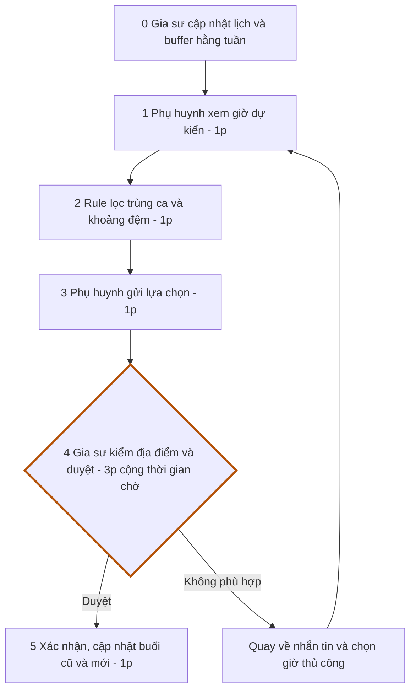

# Báo cáo nhóm — Day 02 Discovery & Problem Framing

> Bản chung của nhóm, viết trên repo do nhóm trưởng fork. Không copy file này sang repo cá nhân.
> Template chi tiết và prompt mẫu: [docs/01-worksheet.md](../../docs/01-worksheet.md). Bài mẫu: [docs/02-deliverable-example.md](../../docs/02-deliverable-example.md).

## 1. Thông tin nhóm

- Tên nhóm: CapK
- Thành viên: Cao Phạm Tân Khải - 2A202603883
- Candidate problem được chọn (1 câu): Phụ huynh có nhu cầu đổi buổi học gia sư nhưng phải đợi các lượt kiểm tra, đề xuất và xác nhận lịch, đôi khi kéo dài vài giờ đến hôm sau.
- Quyết định cuối: Not Yet 

---

## 2. Hội tụ nhóm (CP3)

### 2.1. Pitch

|---:|---|---|---|---|---|
| 1 | Cao Phạm Tân Khải | Khi gần đến giờ học, học sinh muốn xác nhận buổi học có diễn ra để chuẩn bị đúng giờ. | Học sinh | Phải nhắn hỏi lại do không chắc lịch | Chưa có |
| 2 | Cao Phạm Tân Khải | Khi hết tuần, phụ huynh muốn nhận đánh giá tiến bộ để hỗ trợ con ôn tập. | Phụ huynh, gia sư | Gia sư đối chiếu và viết nhận xét cho từng học sinh | Chưa có |
| 3 | Cao Phạm Tân Khải | Khi phát sinh việc đột xuất, phụ huynh muốn biết giờ học bù khả thi để sắp xếp lại lịch. | Phụ huynh, gia sư | Chờ gia sư phản hồi sau khi kiểm lịch | Chưa có |
| 4 | Cao Phạm Tân Khải | Khi ôn nội dung tuần/chương, học sinh muốn nắm kiến thức và bài trọng tâm để ôn đúng phần cần học. | Học sinh, gia sư | Gia sư chọn lọc kiến thức từ nhiều phần tài liệu | Chưa có |
| 5 | Cao Phạm Tân Khải | Khi luyện một dạng toán, học sinh muốn có các đề tương đương để luyện phương pháp. | Gia sư, học sinh | Soạn nhiều đề khác số liệu và kiểm đáp án | Chưa có |
| 6 | Cao Phạm Tân Khải | Khi ôn bài khó, học sinh muốn luyện các bài cùng dạng để khắc phục điểm yếu. | Gia sư, học sinh | Gia sư tìm và phân loại bài từ nhiều đề | Chưa có |
| 7 | Cao Phạm Tân Khải | Khi mắc bài ở nhà, học sinh muốn có gợi ý để tự giải tiếp trước buổi học sau. | Học sinh | Chờ gia sư đọc và trả lời tin ngoài giờ | Chưa có |
| 8 | Cao Phạm Tân Khải | Khi cuối tháng, gia sư muốn đối chiếu buổi học thực tế để tính học phí đúng. | Gia sư | Đối chiếu nghỉ, học bù, số buổi | Chưa có |
| 9 | Cao Phạm Tân Khải | Khi nhận nhiều ảnh bài tập, gia sư muốn phát hiện lỗi để phản hồi chính xác. | Gia sư | Mở từng ảnh và kiểm từng câu | Chưa có |
| 10 | Cao Phạm Tân Khải | Khi chuẩn bị ôn thi, gia sư muốn đối chiếu đề cương, lỗi sai, ghi chú để chọn bài phù hợp. | Gia sư | Tổng hợp ba nguồn học liệu | Chưa có |
| 11 | Cao Phạm Tân Khải | Khi nghỉ một buổi, học sinh muốn biết phần kiến thức bị lỡ để theo kịp lớp. | Học sinh | Gia sư phải tổng hợp và gửi lại nội dung | Chưa có |
| 12 | Cao Phạm Tân Khải | Khi đến hạn bài tập, gia sư muốn biết ai chưa nộp để nhắc đúng người. | Gia sư | Kiểm tin nhắn và bài nộp rời rạc | Chưa có |

## Top 3 chuẩn bị pitch
| Ưu tiên | Candidate | Lý do | Điều chưa chắc |
|---:|---|---|---|
| 1 | **#3 — Đổi lịch học** | Actor và chuỗi trao đổi rõ; có thể đối chiếu dấu thời gian tin nhắn; có ràng buộc trùng ca/di chuyển | Số lượt đổi lịch thực tế và thời gian chờ có đáng giải? |
| 2 | **#2 — Viết phiếu đánh giá** | Lặp lại hằng tuần; ~10 phút/học sinh; đo tương đối dễ | Bước tốn nhất là tìm dữ liệu hay viết nhận xét? |
| 3 | **#7 — Hỏi bài ngoài giờ** | Pain tác động trực tiếp học sinh; có rủi ro chất lượng khi phản hồi nhanh | Bao nhiêu câu hỏi/tuần, loại gợi ý nào thực sự giúp tự học? |

### 2.2. Cluster


| Cluster | Các candidate đang có | Pattern chung |
|---|---|---|
| A — Sắp xếp và xác nhận lịch | #1 Học sinh hỏi xác nhận buổi học; #3 Phụ huynh đổi lịch | Khó nắm được trạng thái lịch chính xác và kịp thời khi các bên chưa cùng online |
| B — Theo dõi, tổng hợp kết quả học | #2 Phiếu đánh giá tuần; #4 Tóm tắt kiến thức/bài trọng tâm | Mất thời gian tổng hợp ghi chú, tài liệu thành thông tin có ích cho người nhận |
| C — Chuẩn bị và hỗ trợ luyện tập | #5 Soạn 5 đề cùng dạng; #6 Chọn bài toán khó; #7 Hỏi bài ngoài giờ | Tài liệu và hỗ trợ học sinh chưa luôn sẵn có đúng lúc, đúng dạng toán |


### 2.3. Opportunity Solution Tree rút gọn

**Cây minh họa để nhóm tự phản biện/chỉnh lại**, với giả định nhóm chọn vấn đề đổi lịch học. Không đưa tên sản phẩm hoặc giải pháp vào tầng Opportunity.

```text
OUTCOME: Giảm thời gian phụ huynh phải đợi để biết các khung giờ học bù khả thi
├── Opportunity A: Phụ huynh không biết khung giờ nào của gia sư đang trống
├── Opportunity B: Gia sư phải đọc tin và đối chiếu lịch mới trả lời được
├── Opportunity C: Nhiều vòng nhắn tin do các khung giờ đề xuất chưa hợp lịch phụ huynh
└── Opportunity D: Khung giờ tưởng trống có thể không đủ thời gian di chuyển giữa hai lớp

Không đặt ở tầng opportunity:
✗ "Xây chatbot đổi lịch học"                  (solution)
✗ "Làm AI Agent tự đẩy các ca học khác"      (solution)
✗ "Tạo app booking"                          (solution)

### 2.4. Chấm điểm shortlist (1–5)

| Candidate | Actor rõ | Quy trình rõ | Pain có bằng chứng | Impact đo được | Vừa sức lab | So sánh được No AI/Rule/Workflow/Agent | Nhóm hiểu domain | Tổng |

| Candidate | Actor rõ | Quy trình rõ | Pain có bằng chứng | Impact đo được | Vừa sức lab | So sánh 4 mức | Hiểu domain | Tổng |
|---|---:|---:|---:|---:|---:|---:|---:|---:|
| #3 — Đổi lịch | 5 | 5 | 2 | 4 | 4 | 5 | 5 | **30/35** |
| #2 — Phiếu đánh giá | 5 | 5 | 4 | 5 | 5 | 4 | 5 | **33/35** |
| #7 — Hỏi bài ngoài giờ | 5 | 4 | 2 | 3 | 3 | 4 | 5 | **26/35** |

**Candidate được ưu tiên phân tích sâu:** #3 — Đổi lịch. **Vì sao chọn dù điểm thấp hơn #2:** có các lượt chuyển giao và chờ rõ ràng, ràng buộc thực tế về lịch cá nhân/di chuyển, và có thể nghiên cứu cụ thể liệu một quy trình đơn giản có đủ hay không. Đây là quyết định ưu tiên học tập theo đề xuất cá nhân, **không có nghĩa #3 đã chứng minh impact cao hơn #2**.

**Vì sao tạm loại:** #2 thực ra có điểm tốt hơn và là phương án dự phòng nếu kiểm chứng cho thấy việc đổi lịch quá hiếm. #7 có nguy cơ gợi ý sai kiến thức toán và khó đo tác động học tập trong một lab ngắn. **Xử lý bất đồng:** chưa có bất đồng nhóm do chỉ một người thực hiện; cần coach xác nhận ngoại lệ quy định nhóm 3–4 người.
---

## 3. Kiểm chứng + research giải pháp đã có (CP4)

### 3.1. Assumption Map

| # | Giả định | Loại | Quan trọng (1–5) | Bằng chứng đã có (1–5) | Kiểm chứng trước? |
|---:|---|---|---:|---:|---|
| 1 | Việc đổi lịch xảy ra đủ thường xuyên để đáng thay đổi cách làm | Value | 5 | 1 | **Có** |
| 2 | Thời gian chờ phản hồi chiếm phần lớn tổng thời gian chốt ca | Value | 5 | 2 | **Có** |
| 3 | Phụ huynh có thể chọn từ giờ trống được hiển thị thay vì nhắn qua lại | Usability | 4 | 1 | **Có** |
| 4 | Gia sư duy trì được lịch bận và lịch dạy cập nhật đúng | Feasibility | 5 | 1 | **Có** |
| 5 | Quy tắc trùng ca và khoảng đệm đủ lọc phần lớn giờ không phù hợp | Feasibility | 4 | 2 | **Có** |
| 6 | Có thể chia sẻ giờ trống mà không lộ dữ liệu học sinh khác và không tăng công duy trì | Viability | 4 | 1 | **Có** |


**Giả định ưu tiên #1, #2 và #4: nếu yêu cầu đổi lịch hiếm, hoặc vấn đề chủ yếu do phụ huynh không phản hồi, hay lịch của gia sư thiếu chính xác, hướng can thiệp phải thay đổi. Điểm chỉ là **tự đánh giá bằng chứng hiện có**, không phải kết quả kiểm chứng.

### 3.2. Kiểm chứng

Cách đã dùng: Phỏng vấn / Survey / Log, ticket, review

Interview snapshot (mỗi buổi phỏng vấn một bảng, hoặc đặt file trong `report/assets/cp4-interview-snapshot-N.md`):

| Trường | Nội dung |
|---|---|
| Người được hỏi (vai trò, không ghi tên thật) | Gia sư |
| Câu nói đáng nhớ nhất (nguyên văn) | Mình từng bị phụ huynh tự ý đổi lịch 2 lần trong 1 ngày |
| Lần gần nhất gặp vấn đề này: chuyện gì đã xảy ra? | Phụ huynh muốn dối lịch học nhưng khi tìm được lịch thì phụ huynh lại không xếp được |
| Hiện đang xử lý bằng cách nào (workaround)? | Tự xử lý trao đổi với 1 2 phụ huynh khi cần đổi lịch học hoặc đổi lịch 2 lớp cho nhau |
| Mất bao lâu, bao lần? | Mỗi lần ít cũng 30p nhiều có khi vài tiếng hoặc không đổi được lịch |
| Insight / opportunity rút ra | Nên sắp xếp lịch khả thi có thể đổi trước rồi báo với các phụ huynh cần đổi trong đầu tuần |

| Người được hỏi (vai trò, không ghi tên thật) | Gia sư |
| Câu nói đáng nhớ nhất (nguyên văn) | Phụ huynh muốn đổi lịch học nên phải đổi lịch của cả 3 4 học sinh khác |
| Lần gần nhất gặp vấn đề này: chuyện gì đã xảy ra? | Lần đó may mắn có lịch trống và trao đổi ngay với phụ huynh, chốt lịch học trong 15p|
| Hiện đang xử lý bằng cách nào (workaround)? | Tự xử lý trao đổi với 1 2 phụ huynh khi cần đổi lịch học hoặc đổi lịch 2 lớp cho nhau |
| Mất bao lâu, bao lần? | Mỗi lần nhanh thì 15-30p, chờ đợi phản hồi là chính, nhiều có khi vài tiếng hoặc không đổi được lịch |
| Insight / opportunity rút ra | Nên sắp xếp lịch khả thi có thể đổi trước rồi báo với các phụ huynh cần đổi trong đầu tuần |
Tổng hợp:

| Nguồn | Số người / số mẫu | Tín hiệu xác nhận | Tín hiệu phản bác |
| Gia sư bạn của Khải | 2 | Mọi người đều bị đau với việc đổi lịch học | Cũng có những trường hợp nhanh 15p nhưng cũng có trường hợp lên đến vài tiếng |


Nhóm đã sửa problem thế nào sau kiểm chứng: Với những phụ huynh muốn đổi lịch học trong tuần tới, có thể gửi lịch học trống có thể học. Gia sư cũng sẽ gửi những lịch học khả thi có thể đổi.

### 3.3. Research giải pháp đã có

| Công cụ / pattern | Link nguồn | Giải bước nào? | Điểm mạnh đã xác minh | Khoảng trống / rủi ro cho bài toán này | Bài học |
|---|---|---|---|---|---|
| **Google Calendar — Appointment schedules** | [Google Calendar Help](https://support.google.com/calendar/answer/11608416?hl=en); [Availability & buffer](https://support.google.com/calendar/answer/11423292?hl=en) | Công khai ca còn trống; chặn giờ đã bận; đặt buffer | Có trang booking; có thể điều chỉnh khung giờ và khoảng đệm trước/sau ca | Booking mặc định là đặt hẹn, **không nên đồng nhất với đề nghị đổi buổi đã được gia sư duyệt**; cần kiểm buổi cũ, địa điểm và ca của người khác | Dùng lịch để giảm bước tìm giờ, giữ duyệt thủ công khi dời buổi đã có |
| **Calendly** | [Reschedule](https://calendly.com/help/how-to-reschedule-a-meeting); [Buffers](https://calendly.com/help/how-to-use-buffers) | Chọn ca thay thế, thay đổi lịch hẹn, thông báo | Có cơ chế reschedule và khoảng đệm giữa các cuộc hẹn | Chi tiết cách đổi và gói tính năng phụ thuộc cấu hình/gói; khoảng đệm tĩnh không bảo đảm đáp ứng mọi chặng di chuyển | Không cần viết Agent để xử lý phần lớn việc chọn giờ |
| **TutorCruncher** | [Calendar & Scheduling](https://tutorcruncher.com/features/calendar-and-scheduling) | Quản lý lịch gia sư, ca học, nhắc lịch, đặt buổi | Sản phẩm chuyên gia sư: lịch tập trung, ca trống và nhắc lịch; cho phép quản lý địa điểm | Có thể phức tạp và tốn công/cước phí cho một gia sư cá nhân; chưa thử thực tế | Chỉ xem xét khi quy mô ca/học viên đủ lớn |
---

## 4. Quy trình trước/sau (CP5)

### 4.1. Quy trình hiện tại


| Bước | Actor | Input | Output | Thời gian/lượt | Handoff / ghi chú |
|---:|---|---|---|---|---|
| 1 | Phụ huynh | Lịch cũ, lý do và nhu cầu đổi | Tin yêu cầu | 1 phút  | Sang gia sư |
| **2** | Phụ huynh chờ / gia sư tiếp nhận | Tin chưa đọc/đang bận | Gia sư tiếp nhận yêu cầu | **60–90 phút ** | **BOTTLENECK chính** |
| 3 | Gia sư | Lịch dạy, lịch cá nhân, quãng di chuyển | Danh sách giờ khả thi | 5 phút  | Chưa chắc đủ dữ liệu địa điểm |
| 4 | Gia sư | Danh sách giờ | Tin đề xuất | 1 phút  | Sang phụ huynh |
| 5 | Phụ huynh chờ | Tin đề xuất | Phụ huynh đọc được tin | 60–90 phút  | Chờ vòng 2 |
| 6 | Phụ huynh | Các giờ khả thi | Ca ưu tiên | 1 phút  | Sang gia sư |
| 7 | Gia sư chờ/xem tin | Lựa chọn của phụ huynh | Yêu cầu chốt | 60–90 phút  | Chờ vòng 3 |
| 8 | Gia sư | Ca ưu tiên, lịch cập nhật | Xác nhận/đề nghị lại | 1 phút | Có thể phải kiểm lại xung đột |
| 9 | Hai bên | Giờ đã chốt | Lịch mới | 2 phút  | Cả hai cần nhận thông báo |


### 4.2. Quy trình tương lai



| Bước | Actor / cách làm | Input → Output | Thời gian [ƯL] | Loại |
|---:|---|---|---|---|
| 0 | Gia sư cập nhật lịch dạy, bận cá nhân, thời gian đệm | Lịch tuần → nguồn ca trống đáng tin | ~10 phút/tuần (chi phí duy trì riêng) | Con người + cấu hình |
| 1 | Phụ huynh xem các ca dự kiến | Link/bảng giờ trống → ca phù hợp sở thích | ~1 phút | Con người |
| 2 | Kiểm điều kiện lịch | Ca trống + độ dài + buffer → ca không trùng | ~1 phút | **Rule** |
| 3 | Phụ huynh yêu cầu đổi | Ca dự kiến → yêu cầu chờ duyệt | ~1 phút | Con người |
| 4 | Gia sư kiểm cuối cùng | Địa điểm, thời gian di chuyển, lịch vừa đổi → đồng ý/từ chối | ~3 phút **khi đã xem yêu cầu**, chưa rõ thời gian chờ | **HITL** |
| 5 | Gia sư/công cụ cập nhật và gửi thông báo | Ca đã duyệt → lịch mới của hai bên | ~1 phút | Con người / Rule sau phê duyệt |

**Boundary:** không tự ý thay buổi học của học sinh khác, không rút ngắn thời lượng, không tự xác nhận một yêu cầu chỉ vì còn giờ trống; không công khai tên, địa chỉ hoặc nội dung buổi học của người khác. **HITL:** gia sư là người kiểm tra di chuyển và duyệt đổi; phụ huynh đồng ý với giờ mới. **Fallback:** nếu lịch chưa cập nhật, tool lỗi hoặc không có ca hợp lệ, quay về nhận 2–3 giờ ưu tiên qua tin nhắn và gia sư tự đối chiếu, xác nhận thủ công; không tự hủy buổi cũ cho đến khi đổi thành công.

**Cảnh báo triển khai:** Google Calendar/Calendly có thể tự xác nhận một cuộc hẹn khi đặt; nếu dùng booking page để *đề nghị đổi*, cần cấu hình/quy trình riêng để trạng thái đó không bị hiểu là buổi học mới đã chốt. Không coi tính năng đặt hẹn sẵn có là cơ chế phê duyệt của gia sư.

### 4.3. Before / after

| Chỉ số | Trước  | Sau (kỳ vọng , chưa chạy) | Ghi chú |
|---|---|---|---|
| Số bước | 9 bước kể cả 3 lượt chờ | 5 bước xử lý + 1 bước cập nhật lịch mỗi tuần | Khác chi phí duy trì lịch |
| Thời gian thao tác | ~11 phút  | ~7 phút/yêu cầu + ~10 phút/tuần cập nhật lịch  | Không đồng nhất với thời gian chờ |
| **Thời gian nhận giờ trống** | Lượt chờ đầu 60–90 phút , chưa đo | **Target:** ≤5 phút ở ≥90% yêu cầu | Đo `request_at → slots_shown_at` |
| **Thời gian chốt đổi lịch** | 191–281 phút là kịch bản , không phải baseline | Chưa có số đáng tin vì bước duyệt vẫn chờ người | Đo `request_at → tutor_approved_at` |
| Số bước thủ công | 6 bước thao tác của con người | 3 bước người dùng/gia sư trong chuỗi chính; 2 bước Rule/công cụ | Chưa tính chuẩn bị lịch mỗi tuần |
| Bottleneck | Chờ gia sư đọc và kiểm lịch | Chờ gia sư duyệt ngoại lệ | Chưa chắc có thể rút ngắn hoàn toàn |
| Rủi ro mới | Trao đổi nhiều lượt, quên cập nhật | Lịch trống sai, thiếu buffer, hiểu nhầm trạng thái, lộ dữ liệu | Cần kiểm tra trước khi xác nhận |


## 5. Problem Statement v0 (CP5)

| Trường | Nội dung |
|---|---|
| **Actor** | Phụ huynh đang thuê gia sư cá nhân cho con và gia sư có nhiều buổi học cần phối hợp lịch. |
| **Quy trình** | Khi đổi buổi học: phụ huynh nhắn → chờ gia sư xem lịch → gia sư đề xuất giờ → phụ huynh chọn → gia sư xác nhận → hai bên cập nhật. |
| **Bottleneck** | **Bước chờ gia sư xem lịch và phản hồi lần đầu**; có thể tiếp tục chờ khi trao đổi vòng sau. |
| **Impact** |  yêu cầu đôi khi kéo dài **vài giờ hoặc đến ngày hôm sau**; chưa xác nhận được số phụ huynh, lượt/tháng hoặc số phút thực tế. |
| **Success Metric** | **Baseline tạm để thiết kế phép đo:** lượt chờ đầu khoảng **60–90 phút [ƯL, chưa đo]**. **Target pilot:** ≥90% yêu cầu nhận được danh sách giờ thay thế *dự kiến* trong ≤5 phút; không có lịch trùng/thiếu buffer đã được xác nhận. **Cách đo:** ghi thời điểm gửi yêu cầu, hiển thị giờ trống và chốt lịch cho từng lượt thực; báo median, p90 và số lỗi. |
| **Boundary** | Mọi thay đổi buổi học phải được hai bên đồng ý; không tự dời ca của người thứ ba, không giảm giờ học, không công bố lịch riêng của học sinh khác; gia sư kiểm trước khi xác nhận. |

**Phản biện của AI đối với v0:** (1) số lần đổi lịch có thể quá ít; (2) mục tiêu nhận giờ trống không đồng nghĩa đổi lịch xong; (3) giờ trống trên lịch không bảo đảm đủ thời gian di chuyển. **Tiếp thu vào v1:** thu hẹp actor, bổ sung metric chất lượng và trạng thái chờ duyệt; không dùng mức độ nhanh của việc nhìn lịch để thay cho thời gian xác nhận cuối cùng.
-

---

## 6. Mức can thiệp AI (CP6)

### 6.1. Ma trận độ mơ hồ × độ phức tạp

- **Độ mơ hồ: thấp** đối với điều kiện giờ trống, ca trùng và độ dài buổi; tăng lên **trung bình** khi chưa biết địa điểm hay thời gian di chuyển.
- **Độ phức tạp: thấp–trung bình** trong phạm vi một gia sư, vì các bước có thể quy định trước và dữ liệu chủ yếu là lịch học/lịch cá nhân.
- **Ô phù hợp:** mơ hồ thấp × phức tạp thấp–trung bình. **Rule hoặc quy trình No AI** có thể đủ; Agent chưa có lý do thuyết phục.
### 6.2. So sánh 4 mức

| Mức | Phương án | Đủ khi nào | Rủi ro | Chọn? |
|---|---|---|---|---|
| **No AI** | Bảng giờ trống/định dạng yêu cầu thống nhất, phụ huynh gửi 2–3 giờ | Ít ca đổi, gia sư cập nhật lịch thủ công ổn định | Vẫn phải xem tin và đối chiếu ca thủ công | **Thử trước nếu không mất công** |
| **Rule** | Lọc ca trùng, thời lượng, buffer; thông báo và lưu timestamp | Điều kiện có thể mô tả bằng quy tắc cố định | Lịch cập nhật thiếu, di chuyển thực tế thay đổi | **Mức đề xuất nếu No AI chưa đủ** |
| **Workflow** | Chuỗi bước cố định có LLM diễn giải tin nhắn tự do, Rule tra giờ, gia sư duyệt | Có bằng chứng yêu cầu bằng ngôn ngữ tự do quá khó nhập theo form | Hiểu sai ngày/giờ, tốn chi phí kiểm | Không chọn hiện tại |
| **Agent** | Tự lập kế hoạch, tự thương lượng, tự chọn công cụ và ca tiếp theo | Có quy trình nhiều nhánh không thể định sẵn và được ủy quyền rõ | Tự dời người khác, rủi ro quyền truy cập và lịch sai | Không chọn |


**Mức chọn:** Rule


### 6.3. AI Canvas rút gọn

**Không áp dụng cho lựa chọn Rule.** Hệ thống chỉ cần kiểm các điều kiện logic có đúng/sai rõ: giờ không trùng, đủ thời lượng, đủ buffer. Không có bước AI dự đoán/viết nội dung. **Input** là lịch dạy, lịch cá nhân, thời lượng và khoảng đệm; **Action** chỉ xảy ra sau gia sư duyệt; **Outcome** đo bằng thời gian và lỗi lịch. Theo worksheet, chọn No AI/Rule không bắt buộc AI Canvas.
### 6.4. Hai câu hỏi của Google PAIR

**Không bắt buộc với Rule.** Tuy vậy, boundary đề xuất theo nguyên tắc **augment**: hệ thống chỉ đưa danh sách ca có thể chọn, **gia sư và phụ huynh giữ quyền quyết định**. Với logic lịch, **báo nhầm ca hợp lệ** (thực tế trùng ca/thiếu buffer) gây hậu quả nặng hơn **bỏ sót một ca trống**, vì trường hợp bỏ sót còn có thể xử lý thủ công. Đây là **ưu tiên thiết kế**, chưa phải ý kiến người dùng đã phỏng vấn.


## 7. Problem Statement v1 + tiêu chí đánh giá (CP6)

| Trường | Nội dung |
|---|---|
| **Actor** | Phụ huynh cần đổi lịch học với **gia sư cá nhân có nhiều ca/địa điểm dạy** và phải đảm bảo khoảng di chuyển giữa các ca. Đây là **phạm vi đề xuất** cần xác minh. |
| **Quy trình** | Gửi yêu cầu đổi → tìm giờ trống phù hợp → phụ huynh chọn giờ → gia sư kiểm di chuyển và xác nhận → hai bên cập nhật; vẫn có thể phát sinh nhiều lượt chờ. |
| **Bottleneck** | Phụ huynh **không biết ca trống khả thi và phải chờ gia sư đối chiếu**, đặc biệt ở lượt phản hồi đầu tiên. |
| **Impact** | Có trường hợp chờ vài giờ/đến hôm sau; chưa biết tần suất/tháng. Chưa tuyên bố tác động rộng. |
| **Success Metric** | **Baseline:** lượt chờ đầu **60–90 phút [ƯL]** (phải thay bằng median/p90 từ timestamp trước pilot); **target:** ≥90% lượt đổi thấy *ca dự kiến hợp lệ* trong ≤5 phút, **100% ca đã chốt** không trùng lịch/thiếu buffer; **metric bổ sung:** thời gian từ yêu cầu đến xác nhận cuối không tăng so baseline. **Đo:** log `request_at`, `slots_shown_at`, `tutor_approved_at`, `calendar_updated_at`; đánh giá theo từng yêu cầu và lỗi. |
| **Boundary** | Không có quyền tự dời buổi người khác, giảm thời lượng, công khai lịch riêng hay xác nhận ca chưa được gia sư duyệt. Phụ huynh và gia sư phải đồng ý khi cập nhật buổi cũ/mới. |
| **AI intervention point** | **Không có.** Điều kiện tìm giờ trống là logic cố định; chưa có căn cứ bổ sung LLM. |
| **Mức chọn** | **Rule** (đề xuất cho pilot nếu No AI không đủ); không chọn Workflow hoặc Agent. |
| **Rủi ro & người kiểm tra** | Lịch thiếu cập nhật, ca trùng hoặc thiếu giờ di chuyển → **gia sư kiểm và duyệt**; phụ huynh đối chiếu giờ mới; gặp lỗi thì quay về tin nhắn thủ công. |
**Thay đổi so với v0 và lý do:**

| Trường | v0 | v1 | Vì sao đổi |
|---|---|---|---|
| Actor | Phụ huynh thuê gia sư cá nhân | Thu hẹp ở gia sư nhiều ca/địa điểm | Ràng buộc buffer/di chuyển khiến ca trống phải được xác nhận; cần kiểm trong thực tế |
| Bottleneck | Chờ phản hồi lần đầu | Không nhìn thấy **ca trống khả thi**, nên phải chờ đối chiếu nhiều lần | Phân tích chuỗi bước; chưa có phỏng vấn xác nhận |
| Success Metric | Thấy giờ trống ≤5 phút | Giữ tốc độ **và** thêm 0 lỗi lịch, không làm chậm thời gian chốt | Phản biện: nhanh không đồng nghĩa đúng hoặc đã chốt |
| Boundary | Gia sư duyệt | Phân biệt *ca dự kiến* và *ca đã xác nhận* | Research: booking page có thể tự tạo lịch, cần tránh sai trạng thái |


**Tiêu chí đánh giá đầu ra của AI (3–5 tiêu chí):**

| # | Tiêu chí | Đạt khi | Không đạt khi |
|---:|---|---|---|
| 1 | Không trùng lịch | **100%** ca đã chốt không chồng giờ với lịch hiện hành | Có ít nhất 1 ca trùng đã được xác nhận |
| 2 | Đủ thời lượng và di chuyển | **100%** ca chốt đủ thời lượng và buffer do gia sư đặt | Chốt ca không đủ thời gian/di chuyển |
| 3 | Thấy ca phù hợp nhanh | ≥90% yêu cầu thấy giờ dự kiến trong ≤5 phút | Không đạt ngưỡng trên trong pilot |
| 4 | Đúng trạng thái duyệt | **100%** yêu cầu chưa duyệt không được thông báo “đã chốt”; buổi cũ chỉ sửa sau khi duyệt | Tự động hủy/đổi khi chưa có sự đồng ý |
| 5 | Bảo mật dữ liệu lịch | Không hiển thị tên, số điện thoại, địa chỉ hay nội dung lịch của học sinh khác | Có bất kỳ dữ liệu riêng nào bị lộ |


---

## 8. Quyết định (CP6)

### 8.1. Bốn rủi ro

| Rủi ro | Câu hỏi | Mức độ rủi ro | Lý do / bằng chứng |
|---|---|---|---|
| **Value** | Người dùng có thực sự gặp pain đủ nhiều? | **Cao** | [STT] mô tả chờ lâu, nhưng thiếu số lượt, người ngoài xác nhận và timestamp; ước lượng không thay bằng chứng |
| **Usability** | Phụ huynh và gia sư có hiểu, dùng được? | **Trung bình** | Trang giờ trống có thể thuận tiện nhưng chưa thử với phụ huynh thật; dễ nhầm “đã chọn” thành “đã chốt” |
| **Feasibility** | Có công cụ, dữ liệu, kỹ năng? | **Trung bình** | Có công cụ lịch hiện có, nhưng lịch cá nhân chưa đối chiếu và buffer cố định chưa chắc xử lý được di chuyển |
| **Viability** | Có hợp công sức, chi phí, quyền riêng tư? | **Trung bình** | Gia sư phải duy trì lịch đúng; chưa lượng hóa chi phí; cần bảo vệ thông tin học sinh khác |

### 8.2. Kết luận

**Quyết định phân tích hiện tại: NOT YET.** Value còn rủi ro **Cao** và có thể kiểm chứng trong thời gian ngắn. **Không Go để xây Agent**; không khẳng định vấn đề không tồn tại. Lựa chọn có thể được nâng thành **Go phạm vi nhỏ** khi có bằng chứng người dùng và công cụ có sẵn giải được pain tốt hơn cách làm cũ.


## 9. Hạn chế và hướng tiếp theo

-

## 10. Tài liệu tham khảo

-
